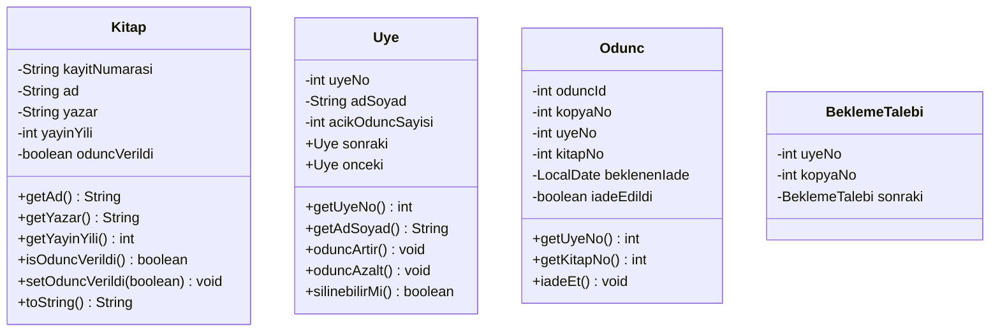
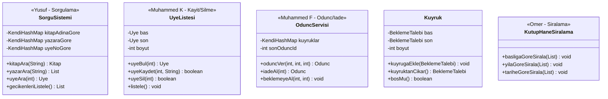
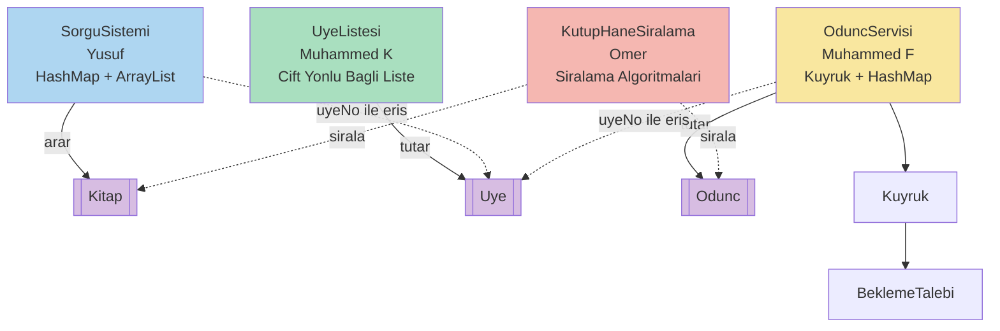
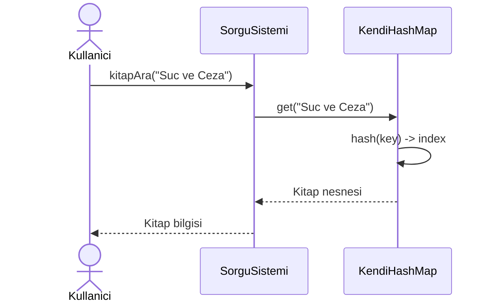
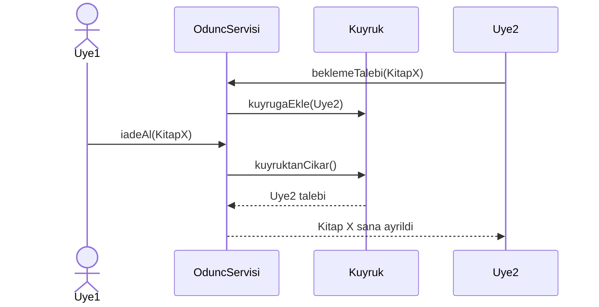

# VY-007 | Kütüphane Ödünç ve İade Takip Sistemi — Sistem UML

> VS Code'da **Ctrl+Shift+V** ile önizlemeyi aç → kareler ve oklar görünür.
> (Önizleme için "Markdown Preview Mermaid Support" eklentisi gerekli.)

---

## 1. Ortak Çekirdek Sınıflar

Sistemde **tek** Kitap ve **tek** Üye olmalı. Şu an herkes kendininkini yazmış.



---

## 2. Her Modülün Sınıfı



---

## 3. Modüller Arası Bağlantı (Kim Kime Bağlı?)



---

## 4. Sıralı Akış — Örnek: Kitap Sorgulama



---

## 5. Sıralı Akış — Örnek: İade + Kuyruk



---

## 6. Veri Yapıları Özet Tablo

| Modül | Geliştirici | Veri Yapısı | Ne için |
|-------|-------------|-------------|---------|
| Sorgulama | Yusuf Şahin | HashMap + ArrayList | O(1) arama, çoklu sonuç |
| Kayıt/Silme | Muhammed Y. Karataş | Çift Yönlü Bağlı Liste | Dinamik ekle/sil |
| Ödünç/İade | Muhammed F. Akkösem | Kuyruk (FIFO) + HashMap | Adil sıra, hızlı erişim |
| Sıralama | Ömer F. Afşar | Bağlı Liste üstünde sort | Alfabetik / kronolojik |

---

## 7. Tespit Edilen Problemler (Ekip Toplantısı İçin)

1. **Ortak tip yok:** Her modül kendi Kitap/Uye'sini yazmış → birbirini çağıramıyor.
2. **Paket tutarsız:** 3 modül `src/kutuphane/` paketinde, 2 modül kök dizinde.
3. **Hazır koleksiyon:** `SorguSistemi` şu an `java.util.HashMap` kullanıyor →
   ödev kuralı gereği sıfırdan yazılmalı (Yusuf'un kararı).
4. **Derleme hataları:** `sorgulama.java` (`boolen`), `KutupHaneSiralama.java` (syntax).
5. **Alan tutarsızlığı:** Ömer'in kodu `getBaslik()`, `getYayinYili()` bekliyor ama
   Yusuf'un Kitap'ında bu metotlar yok.

---

## 8. Çözüm Önerisi — Ortak Sözleşme

```
src/kutuphane/
├── Kitap.java          <- ORTAK model, herkes kullanir
├── Uye.java            <- Muhammed K
├── Odunc.java          <- Muhammed F
├── BeklemeTalebi.java  <- Muhammed F
├── KendiHashMap.java   <- Yusuf (sifirdan hash tablosu)
├── UyeListesi.java     <- Muhammed K
├── Kuyruk.java         <- Muhammed F
├── SorguSistemi.java   <- Yusuf
└── KutupHaneSiralama.java <- Omer
```
