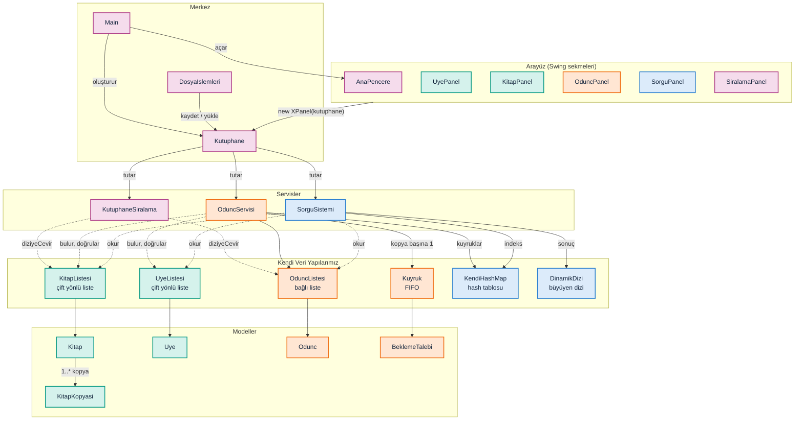
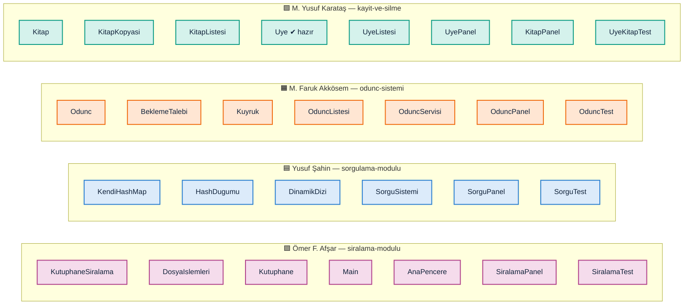
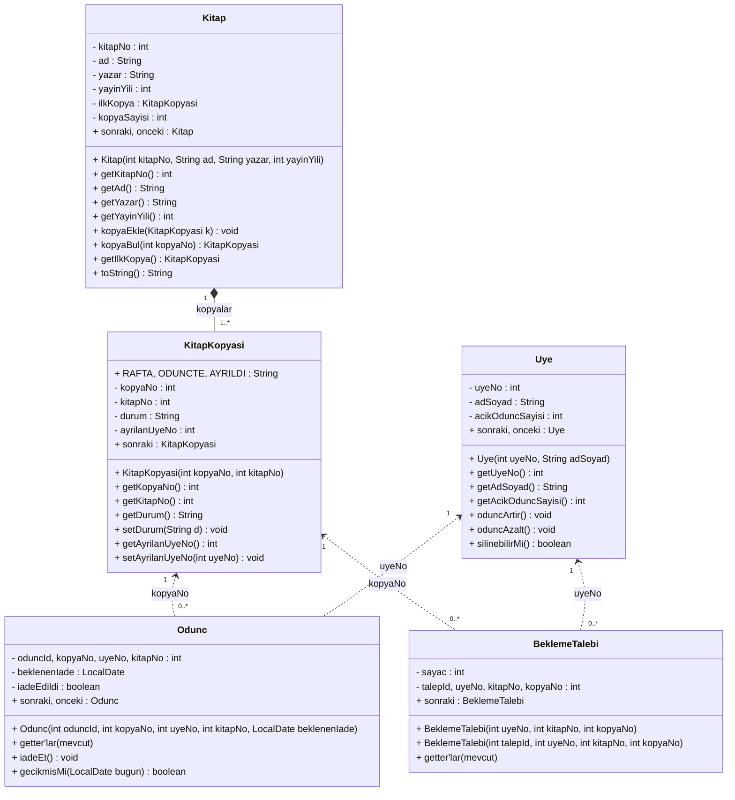
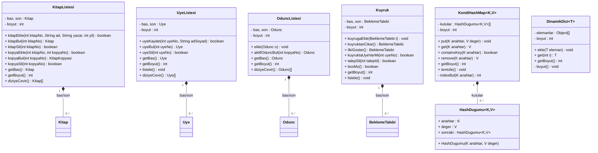
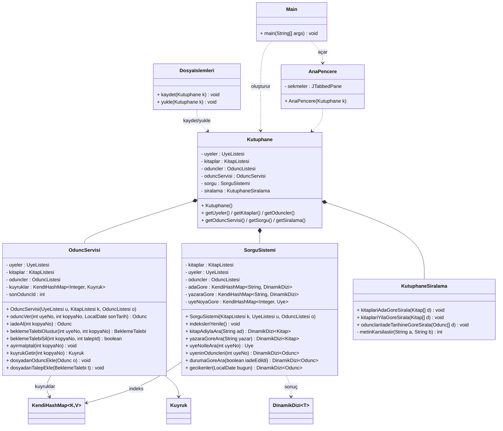
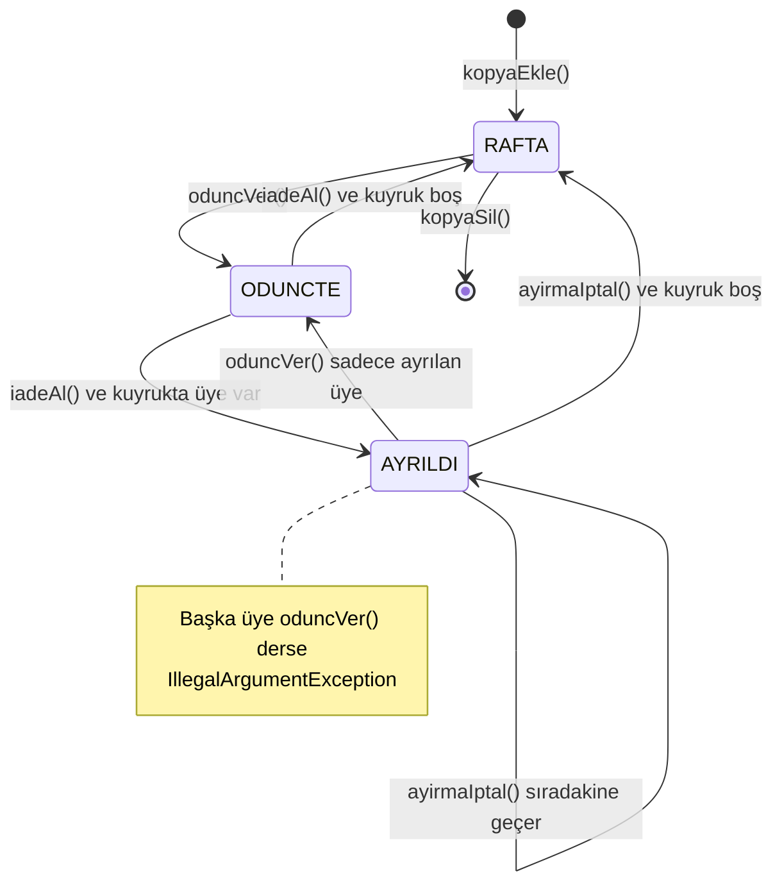
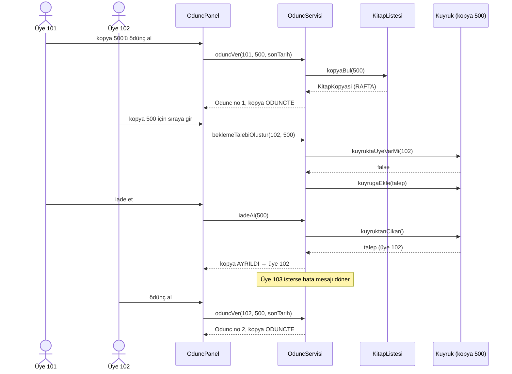
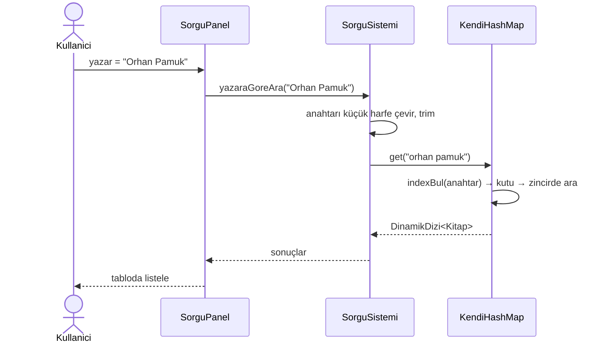
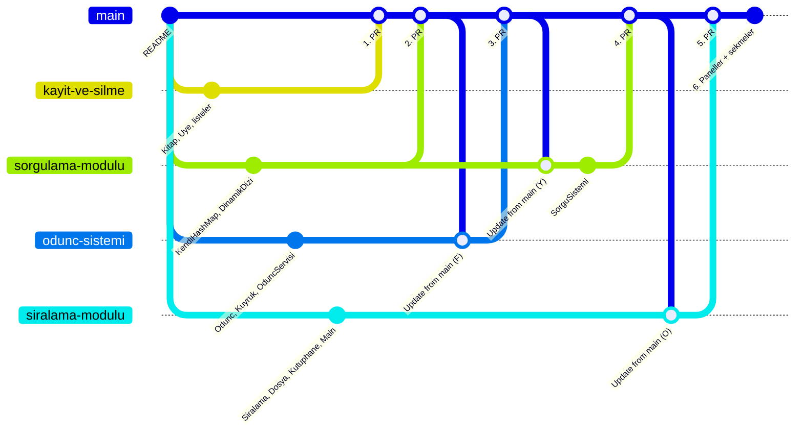

# VY-007 | Kütüphane Ödünç ve İade Takip Sistemi — Ortak Plan ve UML

> VS Code'da **Ctrl+Shift+V** ile önizlemeyi aç → kareler ve oklar görünür.
> (Önizleme için "Markdown Preview Mermaid Support" eklentisi gerekli. GitHub'da kendiliğinden çizilir.)

**Renkler:** 🟩 Muhammed Yusuf Karataş · 🟧 Muhammed Faruk Akkösem · 🟦 Yusuf Şahin · 🟪 Ömer Faruk Afşar

Amaç: 4 modülü tek projede derlenir hale getirmek. Herkes **sadece kendi dosyalarına** dokunur, isimler aşağıdaki sözleşmeye göre yazılır.

---

## 1. Genel Mimari (Kim Kime Bağlı?)

Paneller sadece `Kutuphane` nesnesini alır; `Kutuphane` listeleri ve servisleri tutar; servisler kendi yazdığımız veri yapılarını kullanır.



---

## 2. Kim Hangi Dosyayı Açacak?



| Kişi | Kendi yazdığı veri yapısı | Asıl mantık işi | Arayüz | Yapılacak dosya |
|---|---|---|---|---|
| 🟩 M. Yusuf K. | Çift yönlü bağlı liste (Üye, Kitap) + kopya listesi | Kayıt, silme ve silme kuralları | UyePanel, KitapPanel | 7 (Uye hazır) |
| 🟧 Faruk A. | Kuyruk + ödünç listesi | Ödünç / iade / bekleme kuralları | OduncPanel | 7 |
| 🟦 Yusuf Ş. | Hash tablosu + dinamik dizi | 6 arama türü + indeks | SorguPanel | 6 |
| 🟪 Ömer A. | 3 sıralama algoritması | txt kaydet/yükle + sistemi bağlama | AnaPencere, SiralamaPanel | 7 |

Değişen iki şey: bekleme talepleri tamamen ödünç modülünde (README'de iki kişide yazıyordu); Ömer'e sıralamanın yanında dosya kaydetme ve ana pencere eklendi.

---

## 3. Ortak Model Sınıfları

Sistemde **tek** Kitap, **tek** Üye var. Kimse kendi dosyasının içine ikinci bir Kitap yazmaz.



---

## 4. Kendi Veri Yapılarımız

`java.util` koleksiyonları kullanılmaz; hepsi sıfırdan yazılır.



---

## 5. Servisler ve Merkez



---

## 6. Kitap Kopyasının Durumları

`durum` alanını sadece `OduncServisi` değiştirir. Bu diyagram "iadede ilk bekleyene ayrılan kitap başkasına verilmez" kuralını gösterir.



---

## 7. Sıralı Akış — Ödünç + Bekleme + İade



---

## 8. Sıralı Akış — Yazara Göre Sorgulama



---

## 9. Birleştirme Sırası

Kimse doğrudan `main`'e push etmez. Her parça kendi dalından **Pull Request** ile gelir; sıra, bir dosyanın kullandığı sınıfın main'de önceden var olmasına göre belirlendi.



1. **Temizlik:** Yusuf `main`'deki kök `sorgulama.java`'yı siler. Herkes dosyalarını `src/kutuphane/`'ye taşır, `package kutuphane;` ekler.
2. **PR sırası:** `kayit-ve-silme` → `sorgulama-modulu` (KendiHashMap, HashDugumu, DinamikDizi) → `odunc-sistemi` → `sorgulama-modulu` (SorguSistemi) → `siralama-modulu` → paneller. İlk PR'lar iskelet olabilir (alanlar + imzalar, gövde boş / `return null;`).
3. **Her PR'dan önce:** GitHub Desktop → kendi dalın → *Branch → Update from main* → derle → *Push origin* → *Create Pull Request*.
   ```
   git checkout <kendi-dalın>
   git pull origin main
   javac -d out src/kutuphane/*.java
   git push origin <kendi-dalın>
   ```
4. **Başkasının dosyasına dokunma:** metot lazımsa sahibine yazılır, sahibi ekler.
5. **Son test (main'de):** üye 101, 102 ekle → kitap 1 + kopya 500 → 101'e ödünç → 102 sıraya → 101 iade → kopya `AYRILDI` → 103 alamaz → 102 alır → kapat/aç, veriler txt'den gelir.

---

## 10. Ortak İsimler (Sözleşme)

| Konu | Kural |
|---|---|
| Paket | Her dosyada `package kutuphane;`, hepsi `src/kutuphane/` altında |
| Tek model | `Kitap`, `KitapKopyasi`, `Uye`, `Odunc`, `BeklemeTalebi` projede birer kez |
| Numaralar | `uyeNo`, `kitapNo`, `kopyaNo`, `oduncId`, `talepId` hep `int`; `kopyaNo` sistemde tek → metotlar sadece `kopyaNo` alır |
| Getter adları | `getAd()`, `getYazar()`, `getYayinYili()`, `getKitapNo()`, `getKopyaNo()`, `getUyeNo()`, `getBeklenenIade()` — `getBaslik()` yok |
| Kopya durumu | `KitapKopyasi.RAFTA`, `ODUNCTE`, `AYRILDI` |
| Liste deseni | Model sınıfında `public sonraki/onceki`; listede `bas`, `son`, `boyut`, `getBas()`, `diziyeCevir()` |
| Koleksiyon | `java.util` (List, ArrayList, HashMap, LinkedList, Queue) yok; tarih için `java.time.LocalDate` |
| Hata | Kurala aykırı işlemde `IllegalArgumentException("Türkçe mesaj")`, panel `JOptionPane` ile gösterir |
| Arayüz | Swing; `XPanel extends JPanel`, kurucu `XPanel(Kutuphane k)`; sekmeleri sadece `AnaPencere` ekler |
| main | Uygulamanın tek `main`'i `Main.java`'da; testler `UyeKitapTest`, `OduncTest`, `SorguTest`, `SiralamaTest` |
| Dosya biçimi | Her satır bir kayıt, alanlar `;` ile ayrılır (ör. `uyeler.txt`: `101;Ali Yılmaz`) |
| README | Herkes sadece kendi bölümünü düzenler |

---

## 11. Dosya Listesi

`hazır` = dalda var · `güncelle` = küçük ekleme · `düzelt` = derleme hatası var · `yeni` = açılacak

### 🟩 Muhammed Yusuf Karataş · Kitap & Üye kayıt/silme (`kayit-ve-silme`)

| Dosya | Durum | Not |
|---|---|---|
| `Kitap.java` | yeni | Hem kitap bilgisi hem KitapListesi düğümü (Uye ile aynı desen). |
| `KitapKopyasi.java` | yeni | Durumu yalnızca OduncServisi değiştirir. AYRILDI = iadeden sonra sıradaki üyeye ayrıldı. |
| `KitapListesi.java` | yeni | Çift yönlü bağlı liste. Silme kuralı: kopyaların hepsi RAFTA değilse silinmez. |
| `Uye.java` | hazır | kayit-ve-silme dalında hazır, değişmiyor. |
| `UyeListesi.java` | güncelle | Sadece diziyeCevir() eklenecek (tablo ve sıralama için). |
| `UyePanel.java` | yeni | Üye ekle / sil / listele sekmesi. |
| `KitapPanel.java` | yeni | Kitap + kopya ekle / sil sekmesi. |
| `UyeKitapTest.java` | yeni | Kendi modülünün konsol testi. |

### 🟧 Muhammed Faruk Akkösem · Ödünç / İade / Bekleme (`odunc-sistemi`)

| Dosya | Durum | Not |
|---|---|---|
| `Odunc.java` | güncelle | OduncListesi düğümü olacağı için sonraki/onceki eklenir. |
| `BeklemeTalebi.java` | güncelle | İkinci kurucu sayacı en büyük talepId + 1'e çeker. |
| `Kuyruk.java` | güncelle | talepSil: üye sıradan vazgeçince ortadan düğüm koparır. |
| `OduncListesi.java` | yeni | Tüm ödünç kayıtları (iade edilenler de) burada kalır. |
| `OduncServisi.java` | güncelle | Bütün kurallar burada: kopya RAFTA değilse veya başka üyeye AYRILDI ise ödünç verilmez; aynı üye aynı kopyada iki kez bekleyemez; iadede kuyruktan çıkan üye silinmişse atlanır; ayrılan üye vazgeçerse kopya sıradakine geçer. |
| `OduncPanel.java` | yeni | Ödünç ver / iade al / sıraya gir sekmesi. |
| `OduncTest.java` | güncelle | Şimdiki Maintest.java'nın yeni adı. |

### 🟦 Yusuf Şahin · Sorgulama (`sorgulama-modulu`)

| Dosya | Durum | Not |
|---|---|---|
| `KendiHashMap.java` | güncelle | Şu an sadece String→Kitap; generic yapılınca Faruk da kopyaNo→Kuyruk için kullanır. |
| `HashDugumu.java` | güncelle | Zincirleme (chaining) düğümü. |
| `DinamikDizi.java` | yeni | README'deki ArrayList'in yerine; arama sonuçlarını döndürür. |
| `SorguSistemi.java` | güncelle | Anahtarlar küçük harfe çevrilip trim'lenir. Ekleme/silmeden sonra indeksleriYenile() çağrılır. |
| `SorguPanel.java` | yeni | Arama sekmesi. |
| `SorguTest.java` | yeni | Kendi modülünün konsol testi. |

### 🟪 Ömer Faruk Afşar · Sıralama + Dosya + Ana pencere (`siralama-modulu`)

| Dosya | Durum | Not |
|---|---|---|
| `KutuphaneSiralama.java` | düzelt | List<Kitap> yerine dizi alır; diziyi listelerin diziyeCevir() metodu verir, asıl liste bozulmaz. |
| `DosyaIslemleri.java` | yeni | uyeler.txt · kitaplar.txt · kopyalar.txt · oduncler.txt · talepler.txt — alanlar ; ile ayrılır. |
| `Kutuphane.java` | yeni | Tek merkez nesne. Paneller bunu alır, başka hiçbir şeyi new'lemez. |
| `Main.java` | yeni | Kutuphane oluştur → yukle → AnaPencere göster; kapanırken kaydet. Projedeki tek uygulama main'i. |
| `AnaPencere.java` | yeni | Panel birleşince sekme satırını Ömer ekler. |
| `SiralamaPanel.java` | yeni | Sıralama sekmesi. |
| `SiralamaTest.java` | yeni | Kendi modülünün konsol testi. |

---

## 12. Dallarda Şu An Düzeltilecekler

| Dal | Sorun | Kim |
|---|---|---|
| `main` | Kökte `sorgulama.java`: `java.util` import, `boolen` hatası, derlenmiyor | 🟦 Yusuf |
| `sorgulama-modulu` | İçinde ayrı `Kitap` sınıfı, `package` yok, kökte; `KendiHashMap`'te `get` yok, sadece String→Kitap | 🟦 Yusuf |
| `siralama-modulu` | `import java.util.List`; `for(int i=1 i<n; i++);{` derleme hatası; `getBaslik()` → `getAd()`; metot adlarında "ö"; `KutupHaneSiralama` → `KutuphaneSiralama`; kökte | 🟪 Ömer |
| `odunc-sistemi` | `OduncServisi` sadece println; `Kuyruk`'ta `talepSil` yok; `Maintest` → `OduncTest`; `oduncVer` sadece `kopyaNo` almalı | 🟧 Faruk |
| `kayit-ve-silme` | Kitap/kopya tarafı yok; README başlığındaki "Bekleme Talepleri" çıkmalı; `UyeListesi.diziyeCevir()` | 🟩 M. Yusuf |
| `README` | Ömer'in bölümü dizi üzerinde sıralamaya; Faruk'un bölümü `KendiHashMap`'e güncellenmeli | 🟪 Ömer, 🟧 Faruk |

> Renkli tek sayfalık sürüm: `docs/ortak_plan.html` dosyasını indirip tarayıcıda açın.
