# VY-007 · Ortak Sınıf Planı ve UML

> Takım 7 CompileError · 24 Kasım 2026'daki dallara göre hazırlandı.
> Amaç: 4 modülü tek projede derlenir hale getirmek. Herkes **sadece kendi dosyalarına** dokunur.

## Neden gerekli?

Şu an dallar birleştirilirse proje derlenmez:
- Ortak bir `Kitap` sınıfı yok; `sorgulama.java` kendi Kitap'ını içinde tanımlıyor, sıralama `getBaslik()` bekliyor.
- `sorgulama.java` ve `KutupHaneSiralama.java` kök dizinde, `package` satırları yok.
- `main`'deki `sorgulama.java` (`boolen`) ve sıralama dosyası (`for(int i=1 i<n; i++);{`) derleme hatası veriyor.
- Sıralama `java.util.List` kullanıyor (proje kuralına aykırı).

## UML

```mermaid
classDiagram
    direction TB
    class Kitap {
        - kitapNo : int
        - ad : String
        - yazar : String
        - yayinYili : int
        - ilkKopya : KitapKopyasi
        - kopyaSayisi : int
        + sonraki, onceki : Kitap
        + Kitap(int kitapNo, String ad, String yazar, int yayinYili)
        + getKitapNo() int
        + getAd() String
        + getYazar() String
        + getYayinYili() int
        + kopyaEkle(KitapKopyasi k) void
        + kopyaBul(int kopyaNo) KitapKopyasi
        + getIlkKopya() KitapKopyasi
        + toString() String
    }
    class KitapKopyasi {
        + RAFTA, ODUNCTE, AYRILDI : String
        - kopyaNo : int
        - kitapNo : int
        - durum : String
        - ayrilanUyeNo : int
        + sonraki : KitapKopyasi
        + KitapKopyasi(int kopyaNo, int kitapNo)
        + getKopyaNo() int
        + getKitapNo() int
        + getDurum() String
        + setDurum(String d) void
        + getAyrilanUyeNo() int
        + setAyrilanUyeNo(int uyeNo) void
    }
    class KitapListesi {
        - bas, son : Kitap
        - boyut : int
        + kitapEkle(int kitapNo, String ad, String yazar, int yil) boolean
        + kitapBul(int kitapNo) Kitap
        + kitapSil(int kitapNo) boolean
        + kopyaEkle(int kitapNo, int kopyaNo) boolean
        + kopyaBul(int kopyaNo) KitapKopyasi
        + kopyaSil(int kopyaNo) boolean
        + getBas() Kitap
        + getBoyut() int
        + diziyeCevir() Kitap[]
    }
    class Uye {
        - uyeNo : int
        - adSoyad : String
        - acikOduncSayisi : int
        + sonraki, onceki : Uye
        + Uye(int uyeNo, String adSoyad)
        + getUyeNo() int
        + getAdSoyad() String
        + getAcikOduncSayisi() int
        + oduncArtir() void
        + oduncAzalt() void
        + silinebilirMi() boolean
    }
    class UyeListesi {
        - bas, son : Uye
        - boyut : int
        + uyeKaydet(int uyeNo, String adSoyad) boolean
        + uyeBul(int uyeNo) Uye
        + uyeSil(int uyeNo) boolean
        + getBas() Uye
        + getBoyut() int
        + listele() void
        + diziyeCevir() Uye[]
    }
    class UyePanel {
        + UyePanel(Kutuphane k)
    }
    class KitapPanel {
        + KitapPanel(Kutuphane k)
    }
    class Odunc {
        - oduncId, kopyaNo, uyeNo, kitapNo : int
        - beklenenIade : LocalDate
        - iadeEdildi : boolean
        + sonraki, onceki : Odunc
        + Odunc(int oduncId, int kopyaNo, int uyeNo, int kitapNo, LocalDate beklenenIade)
        + getter'lar (mevcut)
        + iadeEt() void
        + gecikmisMi(LocalDate bugun) boolean
    }
    class BeklemeTalebi {
        - sayac : int
        - talepId, uyeNo, kitapNo, kopyaNo : int
        + sonraki : BeklemeTalebi
        + BeklemeTalebi(int uyeNo, int kitapNo, int kopyaNo)
        + BeklemeTalebi(int talepId, int uyeNo, int kitapNo, int kopyaNo)
        + getter'lar (mevcut)
    }
    class Kuyruk {
        - bas, son : BeklemeTalebi
        - boyut : int
        + kuyrugaEkle(BeklemeTalebi t) void
        + kuyruktanCikar() BeklemeTalebi
        + ilkiGoster() BeklemeTalebi
        + kuyruktaUyeVarMi(int uyeNo) boolean
        + talepSil(int talepId) boolean
        + bosMu() boolean
        + getBoyut() int
        + listele() void
    }
    class OduncListesi {
        - bas, son : Odunc
        - boyut : int
        + ekle(Odunc o) void
        + aktifOduncBul(int kopyaNo) Odunc
        + getBas() Odunc
        + getBoyut() int
        + diziyeCevir() Odunc[]
    }
    class OduncServisi {
        - uyeler : UyeListesi
        - kitaplar : KitapListesi
        - oduncler : OduncListesi
        - kuyruklar : KendiHashMap~Integer, Kuyruk~
        - sonOduncId : int
        + OduncServisi(UyeListesi u, KitapListesi k, OduncListesi o)
        + oduncVer(int uyeNo, int kopyaNo, LocalDate sonTarih) Odunc
        + iadeAl(int kopyaNo) Odunc
        + beklemeTalebiOlustur(int uyeNo, int kopyaNo) BeklemeTalebi
        + beklemeTalebiSil(int kopyaNo, int talepId) boolean
        + kuyrukGetir(int kopyaNo) Kuyruk
        + dosyadanOduncEkle(Odunc o) void
        + dosyadanTalepEkle(BeklemeTalebi t) void
    }
    class OduncPanel {
        + OduncPanel(Kutuphane k)
    }
    class KendiHashMap~K,V~ {
        - kutular : HashDugumu~K,V~[]
        - boyut : int
        + put(K anahtar, V deger) void
        + get(K anahtar) V
        + containsKey(K anahtar) boolean
        + remove(K anahtar) V
        + getBoyut() int
        + temizle() void
        - indexBul(K anahtar) int
    }
    class HashDugumu~K,V~ {
        + anahtar : K
        + deger : V
        + sonraki : HashDugumu~K,V~
        + HashDugumu(K anahtar, V deger)
    }
    class DinamikDizi~T~ {
        - elemanlar : Object[]
        - boyut : int
        + ekle(T eleman) void
        + get(int i) T
        + getBoyut() int
        - buyut() void
    }
    class SorguSistemi {
        - kitaplar : KitapListesi
        - uyeler : UyeListesi
        - oduncler : OduncListesi
        - adaGore : KendiHashMap~String, DinamikDizi~
        - yazaraGore : KendiHashMap~String, DinamikDizi~
        - uyeNoyaGore : KendiHashMap~Integer, Uye~
        + SorguSistemi(KitapListesi k, UyeListesi u, OduncListesi o)
        + indeksleriYenile() void
        + kitapAdiylaAra(String ad) DinamikDizi~Kitap~
        + yazaraGoreAra(String yazar) DinamikDizi~Kitap~
        + uyeNoIleAra(int uyeNo) Uye
        + uyeninOduncleri(int uyeNo) DinamikDizi~Odunc~
        + durumaGoreAra(boolean iadeEdildi) DinamikDizi~Odunc~
        + gecikenler(LocalDate bugun) DinamikDizi~Odunc~
    }
    class SorguPanel {
        + SorguPanel(Kutuphane k)
    }
    class KutuphaneSiralama {
        + kitaplariAdaGoreSirala(Kitap[] d) void
        + kitaplariYilaGoreSirala(Kitap[] d) void
        + odunclariIadeTarihineGoreSirala(Odunc[] d) void
        - metinKarsilastir(String a, String b) int
    }
    class DosyaIslemleri {
        + kaydet(Kutuphane k) void
        + yukle(Kutuphane k) void
    }
    class Kutuphane {
        - uyeler : UyeListesi
        - kitaplar : KitapListesi
        - oduncler : OduncListesi
        - oduncServisi : OduncServisi
        - sorgu : SorguSistemi
        - siralama : KutuphaneSiralama
        + Kutuphane()
        + getUyeler() / getKitaplar() / getOduncler()
        + getOduncServisi() / getSorgu() / getSiralama()
    }
    class Main {
        + main(String[] args) void
    }
    class AnaPencere {
        - sekmeler : JTabbedPane
        + AnaPencere(Kutuphane k)
    }
    class SiralamaPanel {
        + SiralamaPanel(Kutuphane k)
    }
    KitapListesi "1" *-- "0..*" Kitap
    Kitap "1" *-- "1..*" KitapKopyasi
    UyeListesi "1" *-- "0..*" Uye
    OduncListesi "1" *-- "0..*" Odunc
    Kuyruk "1" *-- "0..*" BeklemeTalebi
    KendiHashMap~K,V~ *-- HashDugumu~K,V~
    OduncServisi --> OduncListesi
    OduncServisi --> Kuyruk
    OduncServisi --> KendiHashMap~K,V~
    OduncServisi ..> UyeListesi : doğrular
    OduncServisi ..> KitapListesi : doğrular
    SorguSistemi --> KendiHashMap~K,V~
    SorguSistemi ..> DinamikDizi~T~
    SorguSistemi ..> KitapListesi
    SorguSistemi ..> UyeListesi
    SorguSistemi ..> OduncListesi
    KutuphaneSiralama ..> Kitap
    KutuphaneSiralama ..> Odunc
    Kutuphane *-- UyeListesi
    Kutuphane *-- KitapListesi
    Kutuphane *-- OduncListesi
    Kutuphane *-- OduncServisi
    Kutuphane *-- SorguSistemi
    Kutuphane *-- KutuphaneSiralama
    DosyaIslemleri ..> Kutuphane : kaydet/yukle
    Main ..> Kutuphane
    Main ..> AnaPencere
    AnaPencere *-- UyePanel
    AnaPencere *-- KitapPanel
    AnaPencere *-- OduncPanel
    AnaPencere *-- SorguPanel
    AnaPencere *-- SiralamaPanel
```



Renk/sahip: **M. Yusuf Karataş** → Kitap, Üye, listeler · **M. Faruk Akkösem** → Ödünç, Kuyruk, BeklemeTalebi · **Yusuf Şahin** → Hash tablosu, DinamikDizi, Sorgu · **Ömer F. Afşar** → Sıralama, Dosya, Kutuphane, Main, AnaPencere

## Kim hangi dosyayı açacak

`hazır` = dalda var · `güncelle` = küçük ekleme · `düzelt` = derleme hatası var · `yeni` = açılacak. Hepsi `src/kutuphane/` altında.

### Muhammed Yusuf Karataş · Kitap & Üye kayıt/silme (dal: `kayit-ve-silme`)

| Dosya | Durum | Not |
|---|---|---|
| `Kitap.java` | yeni | Hem kitap bilgisi hem KitapListesi düğümü (Uye ile aynı desen). |
| `KitapKopyasi.java` | yeni | Durumu yalnızca OduncServisi değiştirir. AYRILDI = iadeden sonra sıradaki üyeye ayrıldı. |
| `KitapListesi.java` | yeni | Çift yönlü bağlı liste. Silme kuralı: kopyaların hepsi RAFTA değilse silinmez. |
| `Uye.java` | hazır | kayit-ve-silme dalında hazır, değişmiyor. |
| `UyeListesi.java` | güncelle | Sadece diziyeCevir() eklenecek (tablo ve sıralama için). |
| `UyePanel.java` | yeni | Üye ekle / sil / listele sekmesi. |
| `KitapPanel.java` | yeni | Kitap + kopya ekle / sil sekmesi. |
| `UyeKitapTest.java` | yeni | Kendi modülünün konsol testi. |

### Muhammed Faruk Akkösem · Ödünç / İade / Bekleme (dal: `odunc-sistemi`)

| Dosya | Durum | Not |
|---|---|---|
| `Odunc.java` | güncelle | OduncListesi düğümü olacağı için sonraki/onceki eklenir. |
| `BeklemeTalebi.java` | güncelle | İkinci kurucu sayacı en büyük talepId + 1'e çeker. |
| `Kuyruk.java` | güncelle | talepSil: üye sıradan vazgeçince ortadan düğüm koparır. |
| `OduncListesi.java` | yeni | Tüm ödünç kayıtları (iade edilenler de) burada kalır. |
| `OduncServisi.java` | güncelle | Bütün kurallar burada: kopya RAFTA değilse veya başka üyeye AYRILDI ise ödünç verilmez; aynı üye aynı kopyada iki kez bekleyemez; iadede kuyruktan çıkan üye silinmişse atlanır. |
| `OduncPanel.java` | yeni | Ödünç ver / iade al / sıraya gir sekmesi. |
| `OduncTest.java` | güncelle | Şimdiki Maintest.java'nın yeni adı. |

### Yusuf Şahin · Sorgulama (dal: `sorgulama-modulu`)

| Dosya | Durum | Not |
|---|---|---|
| `KendiHashMap.java` | güncelle | Şu an sadece String→Kitap; generic yapılınca Faruk da kopyaNo→Kuyruk için kullanır. |
| `HashDugumu.java` | güncelle | Zincirleme (chaining) düğümü. |
| `DinamikDizi.java` | yeni | README'deki ArrayList'in yerine; arama sonuçlarını döndürür. |
| `SorguSistemi.java` | güncelle | Anahtarlar küçük harfe çevrilip trim'lenir. Ekleme/silmeden sonra indeksleriYenile() çağrılır. |
| `SorguPanel.java` | yeni | Arama sekmesi. |
| `SorguTest.java` | yeni | Kendi modülünün konsol testi. |

### Ömer Faruk Afşar · Sıralama + Dosya + Ana pencere (dal: `siralama-modulu`)

| Dosya | Durum | Not |
|---|---|---|
| `KutuphaneSiralama.java` | düzelt | List<Kitap> yerine dizi alır; diziyi listelerin diziyeCevir() metodu verir, asıl liste bozulmaz. |
| `DosyaIslemleri.java` | yeni | uyeler.txt · kitaplar.txt · kopyalar.txt · oduncler.txt · talepler.txt — alanlar ; ile ayrılır. |
| `Kutuphane.java` | yeni | Tek merkez nesne. Paneller bunu alır, başka hiçbir şeyi new'lemez. |
| `Main.java` | yeni | Kutuphane oluştur → yukle → AnaPencere göster; kapanırken kaydet. Projedeki tek uygulama main'i. |
| `AnaPencere.java` | yeni | Panel birleşince sekme satırını Ömer ekler. |
| `SiralamaPanel.java` | yeni | Sıralama sekmesi. |
| `SiralamaTest.java` | yeni | Kendi modülünün konsol testi. |

### Neden adil

| Kişi | Kendi yazdığı veri yapısı | Asıl mantık işi | Arayüz | Yapılacak dosya |
|---|---|---|---|---|
| M. Yusuf K. | Çift yönlü bağlı liste (Üye, Kitap) + kopya listesi | Kayıt, silme ve silme kuralları | UyePanel, KitapPanel | 7 (Uye hazır) |
| Faruk A. | Kuyruk + ödünç listesi | Ödünç/iade/bekleme kuralları | OduncPanel | 7 |
| Yusuf Ş. | Hash tablosu + dinamik dizi | 6 arama türü + indeks | SorguPanel | 6 |
| Ömer A. | 3 sıralama algoritması | txt kaydet/yükle + sistemi bağlama | AnaPencere, SiralamaPanel | 7 |

Değişen iki şey: bekleme talepleri tamamen ödünç modülünde (README'de iki kişide yazıyordu); Ömer'e sıralamanın yanında dosya kaydetme ve ana pencere eklendi.

## Ortak isimler (sözleşme)

- **Paket:** her dosyada `package kutuphane;`, hepsi `src/kutuphane/` altında. Kök dizinde `.java` kalmaz.
- **Tek model:** `Kitap`, `KitapKopyasi`, `Uye`, `Odunc`, `BeklemeTalebi` projede birer kez var.
- **Numaralar `int`:** `uyeNo`, `kitapNo`, `kopyaNo`, `oduncId`, `talepId`. `kopyaNo` sistemde tektir → metotlar sadece `kopyaNo` alır.
- **Getter adları:** `getAd()`, `getYazar()`, `getYayinYili()`, `getKitapNo()`, `getKopyaNo()`, `getUyeNo()`, `getBeklenenIade()`. `getBaslik()` yok.
- **Kopya durumu:** `KitapKopyasi.RAFTA`, `ODUNCTE`, `AYRILDI`. Durumu sadece `OduncServisi` değiştirir.
- **Liste düğümü deseni:** Uye'deki gibi model sınıfında `public sonraki/onceki`; listede `bas`, `son`, `boyut`, `getBas()`, `diziyeCevir()`.
- **Hazır koleksiyon yok:** `java.util` (List, ArrayList, HashMap, LinkedList, Queue) kullanılmaz. Tarih için `java.time.LocalDate` kullanılıyor.
- **Hata bildirme:** kurala aykırı işlemde `IllegalArgumentException("Türkçe mesaj")`; panel yakalayıp `JOptionPane` ile gösterir.
- **Arayüz:** Swing. Her panel `XPanel extends JPanel`, kurucusu `XPanel(Kutuphane k)`. Sekmeleri sadece `AnaPencere` ekler.
- **main:** uygulamanın tek `main`'i `Main.java`'da. Testler: `UyeKitapTest`, `OduncTest`, `SorguTest`, `SiralamaTest`.
- **Dosya biçimi:** her satır bir kayıt, alanlar `;` ile ayrılır (ör. `uyeler.txt`: `101;Ali Yılmaz`).
- **README:** herkes sadece kendi bölümünü düzenler.

## Birleştirme planı

Kimse doğrudan `main`'e push etmez; her parça kendi dalından Pull Request ile gelir.

1. **Temizlik:** Yusuf `main`'deki kök `sorgulama.java`'yı siler. Herkes dosyalarını `src/kutuphane/`'ye taşır, paket satırını ekler.
2. **PR sırası** (bağımlılığa göre):
   1. `kayit-ve-silme`: Uye, UyeListesi, Kitap, KitapKopyasi, KitapListesi
   2. `sorgulama-modulu` 1. parça: KendiHashMap, HashDugumu, DinamikDizi
   3. `odunc-sistemi`: Odunc, BeklemeTalebi, Kuyruk, OduncListesi, OduncServisi, OduncTest
   4. `sorgulama-modulu` 2. parça: SorguSistemi, SorguTest
   5. `siralama-modulu`: KutuphaneSiralama, DosyaIslemleri, Kutuphane, Main, AnaPencere (sekmesiz), SiralamaTest
   6. Paneller: herkes kendi panelini gönderir; Ömer `AnaPencere`'ye sekme satırını ekler.

   İlk PR'lar iskelet olabilir (alanlar + imzalar, gövde boş / `return null;`).
3. **Her PR'dan önce:** GitHub Desktop → kendi dalın → *Branch → Update from main* → derle → *Push origin* → *Create Pull Request*.
   ```
   git checkout <kendi-dalın>
   git pull origin main
   javac -d out src/kutuphane/*.java
   git push origin <kendi-dalın>
   ```
4. **Başkasının dosyasına dokunma:** metot lazımsa sahibine yazılır, sahibi ekler.
5. **Son test (main'de):** üye 101, 102 ekle → kitap 1 + kopya 500 → 101'e ödünç → 102 sıraya → 101 iade → kopya `AYRILDI` → 103 alamaz → 102 alır → kapat/aç, veriler txt'den gelir.

## Dallarda düzeltilecekler

| Dal | Sorun | Kim |
|---|---|---|
| `main` | Kökte `sorgulama.java`: `java.util` import, `boolen` hatası, derlenmiyor | Yusuf |
| `sorgulama-modulu` | İçinde ayrı `Kitap` sınıfı, `package` yok, kökte; `KendiHashMap`'te `get` yok, sadece String→Kitap | Yusuf |
| `siralama-modulu` | `import java.util.List`; `for(int i=1 i<n; i++);{` derleme hatası; `getBaslik()` → `getAd()`; metot adlarında "ö"; `KutupHaneSiralama` → `KutuphaneSiralama`; kökte | Ömer |
| `odunc-sistemi` | `OduncServisi` sadece println; `Kuyruk`'ta `talepSil` yok; `Maintest` → `OduncTest`; `oduncVer` sadece `kopyaNo` almalı | Faruk |
| `kayit-ve-silme` | Kitap/kopya tarafı yok; README başlığındaki "Bekleme Talepleri" çıkmalı; `UyeListesi.diziyeCevir()` | M. Yusuf |
| `README` | Ömer'in bölümü dizi üzerinde sıralamaya; Faruk'un bölümü `KendiHashMap`'e güncellenmeli | Ömer, Faruk |

Görsel sürüm (renkli diyagram + UML kartları): `docs/ortak_plan.html` dosyasını tarayıcıda açın.
